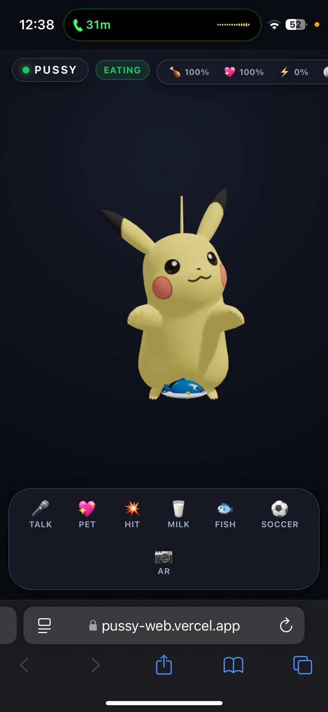
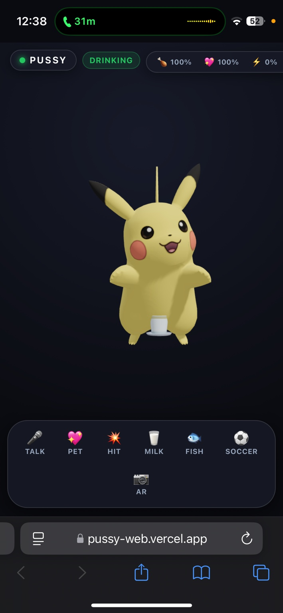
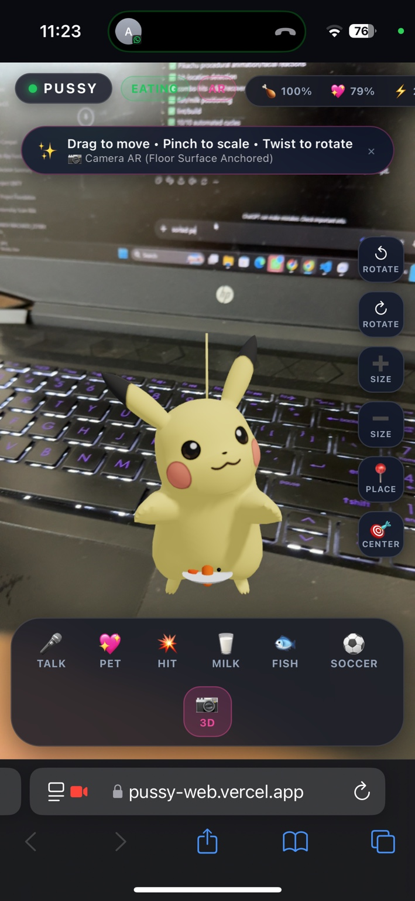
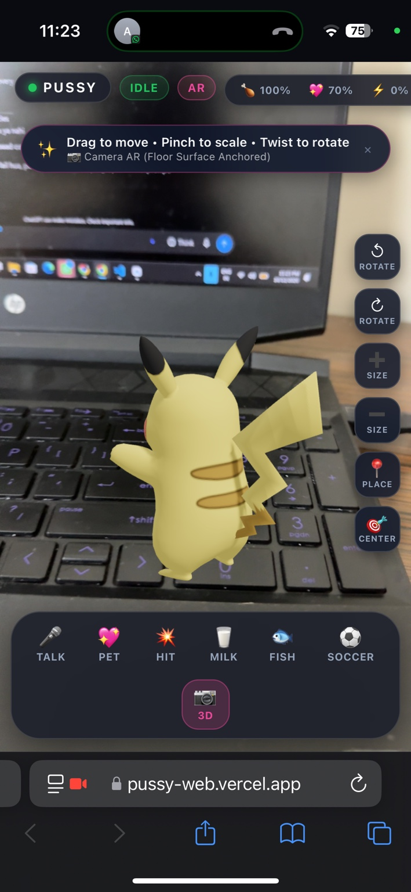

<div align="center">

# ⚡ PUSSY Web

### A living 3D virtual pet that talks, reacts, eats, plays, and steps into the real world.

**React + Vite + TypeScript + Three.js + React Three Fiber + Camera AR**

<p>
  <a href="https://pussy-web.vercel.app">
    
  </a>
  <a href="https://github.com/machadoanish27-ops/pussy-web">
    
  </a>
  <a href="./LICENSE">
    
  </a>
</p>

<p>
  <a href="https://react.dev/"></a>
  <a href="https://vite.dev/"></a>
  <a href="https://www.typescriptlang.org/"></a>
  <a href="https://threejs.org/"></a>
  <a href="https://docs.pmnd.rs/react-three-fiber/"></a>
  <a href="https://vercel.com/"></a>
</p>

</div>

---

## ✨ What is PUSSY?

**PUSSY Web** is a mobile-first, Talking-Tom-style virtual pet built as a modern web app.

Pikachu lives inside the browser instead of inside a traditional game client. You can **pet it, talk to it, feed it, hit it, play soccer with it, save its progress, and place it into the real world through camera mode**.

The goal is simple:

> **Make a browser-based pet feel alive.**

---

## 🎮 The Experience

| Interaction | What happens |
|---|---|
| 🎙️ **Talk** | Pikachu listens, records natural speech, then repeats it with visible mouth lip-sync. |
| 💖 **Pet** | Keep your finger on Pikachu and stroke continuously. The pet stays engaged until the finger is released. |
| 🗣️ **Pet Vocals** | During long petting sessions, the pet can react with the provided Pikachu vocal clip at natural intervals. |
| 🥛 **Milk** | Pikachu drinks while the milk travels into the actual mouth target. |
| 🐟 **Fish** | Pikachu eats while the fish travels into the actual mouth target and disappears at consumption. |
| 💥 **Hit** | Progressive cartoon damage builds through a 10-hit sequence before the full fall/recovery reaction. |
| ⚽ **Soccer** | A lightweight head-soccer mini-game adds a playable loop and rewards. |
| 📷 **AR** | Camera mode lets the same pet live on real-world surfaces with move, scale, and rotation controls. |
| 💾 **Save** | Stats and progression persist locally across sessions. |

---

## 🧠 Why it feels alive

PUSSY is not just a static 3D model placed on a page.

It combines:

- Procedural idle motion
- Breathing and natural body movement
- Eye and facial reactions
- Actual mouth-state animation
- Audio-driven talking lip-sync
- Continuous touch interaction
- Context-aware feeding
- Progressive hit reactions
- Persistent pet stats
- Camera AR interaction

### Core interaction loop

```text
          ┌───────────────┐
          │    IDLE       │
          └───────┬───────┘
                  │
       ┌──────────┼───────────┐
       ▼          ▼           ▼
    LISTEN      PET         FEED
       │          │           │
       ▼          ▼           ▼
    TALKING    HAPPY      EAT/DRINK
       │          │           │
       └──────┬───┴───────────┘
              ▼
          REACTION
              │
              ▼
             IDLE
```

---

# 📸 Screenshots

### 🐟 Normal Mode — Feeding

<p align="center">
  
  
</p>

### 📷 Camera AR

<p align="center">
  
  
</p>

---

## 🚀 Live Demo

### [👉 Open PUSSY Web](https://pussy-web.vercel.app)

The production build is deployed on Vercel and optimized for mobile browsers.

> **Best experience:** open the site on a phone, enable sound, and interact directly with Pikachu.

---

## 🛠️ Tech Stack

```text
Frontend
├── React
├── TypeScript
├── Vite
└── Responsive CSS

3D / Interaction
├── Three.js
├── React Three Fiber
├── Drei
└── Procedural animation

Audio
├── Web Audio API
├── MediaRecorder
├── Microphone input
└── HTML5 Audio asset playback

AR
├── Camera passthrough
├── WebXR capability detection
├── Surface placement
├── Drag / reposition
├── Pinch scale
└── Two-finger rotation

Persistence
└── localStorage

Deployment
├── GitHub
└── Vercel
```

---

## 🏗️ Architecture

```text
PUSSY WEB
│
├── UI
│   ├── Status Bar
│   └── Control Dock
│
├── Pet Engine
│   ├── Pet State Machine
│   ├── Procedural Animator
│   ├── Interaction Controller
│   └── Facial State Resolver
│
├── 3D System
│   ├── Three.js
│   ├── React Three Fiber
│   ├── Pikachu GLB
│   └── Procedural Facial Animation
│
├── Voice System
│   ├── Microphone
│   ├── MediaRecorder
│   ├── Silence Detection
│   ├── 20s Hard Cap
│   └── Audio Playback / Lip-sync
│
├── Feeding
│   ├── Milk
│   └── Fish
│
├── Pet Stats
│   ├── Hunger
│   ├── Happiness
│   ├── Energy
│   ├── XP
│   └── Coins
│
├── Mini Game
│   └── Head Soccer
│
├── Save System
│   └── localStorage
│
└── AR
    ├── Camera
    ├── Placement
    ├── Repositioning
    ├── Pinch
    └── Rotation
```

---

## 💖 Signature Interaction: Continuous Petting

The petting system is **contact-based**, not just swipe-based.

```text
Touch Pikachu
     ↓
Start Petting Session
     ↓
Keep Finger Down
     ↓
Swipe Up / Down / Repeat
     ↓
Pikachu Stays Happy + Engaged
     ↓
Occasional Vocal Reaction
     ↓
Lift Finger
     ↓
Petting Ends
```

That means the user doesn't have to lift and re-touch the pet after every stroke.

---

## 🎙️ Talk System

The Talk interaction is designed around conversational speech instead of a tiny fixed clip.

### Recording behavior

- Natural speech detection
- Brief pauses are tolerated
- Speech can resume within the same recording session
- **20-second hard maximum**
- Sustained silence finalizes the recording
- Playback starts only after recording ends
- Pikachu visibly lip-syncs while repeating the captured speech

### Flow

```text
TALK
  ↓
LISTENING
  ↓
Record Speech
  ↓
Pause Detection
  ↓
Finalize
  ↓
TALKING
  ↓
Lip-sync Playback
  ↓
IDLE
```

---

## 🥛🐟 Feeding System

Feeding is designed around the **actual mouth target**, not an arbitrary position around the feet.

```text
Food Spawn
    ↓
Arc Toward Pikachu
    ↓
Actual Mouth Target
    ↓
Final Bite / Sip
    ↓
Food Disappears
    ↓
Facial State Resets
```

The same logic is used in normal mode and camera mode.

---

## 💥 Progressive Hit System

PUSSY uses a progressive reaction system instead of immediately knocking the pet down.

```text
Hit 1–2    → light recoil
Hit 3–4    → stronger recoil / dazed
Hit 5      → dizzy reaction
Hit 6–7    → bandages / swollen cheeks
Hit 8–9    → heavy recoil / near-fall
Hit 10     → FULL FALL
             ↓
          LIE DOWN
             ↓
          RECOVER
             ↓
        Fresh / Reset
```

---

## 📷 Camera AR

AR mode uses the same Pikachu and the same interaction system.

Supported interactions include:

- Tap to place
- Drag to reposition
- Pinch to scale
- Two-finger twist to rotate
- Camera passthrough
- Pet
- Talk
- Feed
- Hit
- Play

Where full immersive WebXR is unavailable, the app uses capability-aware camera behavior instead of pretending that unsupported tracking exists.

---

## 📱 Mobile First

PUSSY is designed around touch-first interaction.

The UI accounts for:

- Portrait mobile screens
- iOS safe areas
- Android mobile layouts
- Touch targets
- Responsive status information
- Bottom interaction controls
- Camera mode controls

---

## 🔊 Audio Design

The project uses a mixture of:

- Web Audio API for original SFX
- MediaRecorder for user speech
- HTML5 Audio / decoded buffers for the supplied pet vocal asset
- Audio analysis for mouth movement

### Pet vocal asset

The current petting vocal uses the supplied audio asset:

```text
public/audio/pikachu-pet-vocal.mp3
```

During a continuous petting session, the same asset can be replayed at natural intervals rather than firing on every touch event.

---

## 💾 Persistence

Pet progression is stored locally so the browser can restore:

- Hunger
- Happiness
- Energy
- XP
- Coins
- Progression state

The save layer also includes corruption-safe fallback behavior.

---

## 🧪 Verification

The project contains automated regression checks covering:

- Pet stat clamping
- Persistence
- Facial reset
- Food mouth targeting
- Hit escalation
- Fall/recovery
- Continuous petting lifecycle
- Pet vocal scheduling
- Audio asset safety
- Conversational speech detection
- 20-second speech cap

### Local verification

```bash
npm run lint
npm run build
node scripts/verify-logic.mjs
```

Expected result:

```text
✓ lint
✓ production build
✓ regression suite
```

---

## ⚡ Run Locally

```bash
git clone https://github.com/machadoanish27-ops/pussy-web.git
cd pussy-web
npm install
npm run dev
```

Then open the local Vite URL shown in the terminal.

### Production build

```bash
npm run build
```

### Preview production build

```bash
npm run preview
```

---

## 🌐 Deployment

The project is deployed with Vercel.

```text
GitHub
   ↓
main branch
   ↓
Vercel build
   ↓
Production
   ↓
https://pussy-web.vercel.app
```

---

## 📁 Important Project Areas

```text
src/
├── components/
│   ├── controls/
│   ├── pet/
│   ├── ar/
│   └── ui/
│
├── scenes/
├── systems/
│   ├── audio/
│   ├── ar/
│   ├── pet/
│   ├── save/
│   └── stats/
│
├── types/
└── App.tsx

public/
├── audio/
│   └── pikachu-pet-vocal.mp3
└── models/
    └── pikachu.glb
```

---

## 🔐 Permissions

Depending on browser and device, PUSSY may request:

- 🎙️ **Microphone** — Talk mode
- 📷 **Camera** — AR mode

Permissions are requested only when the related feature is used.

---

# 📜 License

## Original Source Code

The **original source code** of this project is licensed under the **MIT License**.

See [`LICENSE`](./LICENSE).

## Third-Party Assets

The following assets are **not automatically covered by the MIT license**:

- `public/models/pikachu.glb`
- `public/audio/pikachu-pet-vocal.mp3`
- Any other third-party character/audio/material assets added to the repository

These assets may be subject to the rights, licenses, or permissions of their respective owners.

See [`THIRD_PARTY_ASSETS.md`](./THIRD_PARTY_ASSETS.md).

> Before commercial distribution or public redistribution, verify that you have the necessary rights for every third-party asset used by the project.

---

## 🧑‍💻 Author

**Anish Machado**

BE Information Technology  
St. Francis Institute of Technology (SFIT), Mumbai

### Links

- 🌐 [Live Demo](https://pussy-web.vercel.app)
- 💻 [GitHub Repository](https://github.com/machadoanish27-ops/pussy-web)

---

## ⭐ Final Note

PUSSY Web started as a simple virtual-pet idea and evolved into a browser-based interactive character system combining:

**3D + Touch + Voice + Audio + Animation + AR + Persistence + Mini-games**

Built to feel less like a webpage...

and more like a **little digital creature living inside your phone.** ⚡

<div align="center">

### 🐾 Touch. Talk. Feed. Play. Repeat.

**Made with React, Three.js, Web APIs, and a lot of Pikachu energy. ⚡**

</div>
